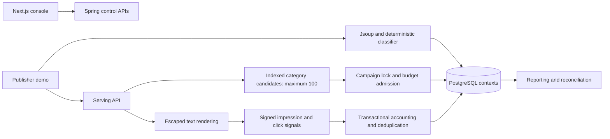

> Historical initial baseline. OIDC, inventory verification and daily pacing supersede the corresponding limitations
> below. See [current design](identity-domains-pacing.md) and [acceptance status](requirements.md).

# Architecture and implementation boundary

This is a development vertical slice, not the complete requested enterprise platform.
A modular Spring application owns control, serving, measurement and accounting. Next.js supplies one role-switching
console and publisher demo. PostgreSQL is the only runtime dependency. Redis, Kafka, OpenSearch, vectors and object
storage are deferred rather than added without working consumers. The durable outbox is recorded but not yet dispatched.

## Model decisions

* Rule-based bounded term counts provide an interpretable initial category classifier. Unknown contexts fail closed.
  Single-label classification and six categories are implemented; this is neither TF-IDF nor BM25. Title is not
  separately weighted. Confidence is heuristic, not calibrated probability. Sensitive-word filtering is demonstrative
  and inadequate for production brand safety.
* Exact category relevance gates a first-price ranking by integer bid, with UUID ascending tie-breaking. Every candidate
  has equal contextual quality in this baseline. Maximum 100 indexed candidates are revalidated under a campaign row
  lock.
* Publisher-provided content avoids SSRF: no URL fetching exists. Domain verification and placement ownership are not
  yet implemented. The stored page is owned by the authenticated publisher account.
* Campaigns use DRAFT/ACTIVE/PAUSED and creative approval. Full lifecycle, exclusions, formats, geography, teams and
  scheduling remain open.
* The deployment uses synchronous authoritative state: pause and approval changes are checked in PostgreSQL. A decision
  already holding the campaign lock may finish before pause takes effect; new acquisitions observe the committed change.
* A production control/data split can replicate versioned candidate snapshots, while retaining authoritative budget
  admission. Strict database admission is the baseline bottleneck. Budget leases are a future optimization requiring
  bounded ownership, durable fencing, and recovery.

## Options and trade-offs

A modular monolith minimizes operational burden but shares scaling/failure domains. Event-driven analytics decouples
reporting but adds replay and schema evolution duties. Control/data separation permits independent capacity and strict
serving deadlines, with snapshot staleness to manage. Global regions require exclusive per-region budget allocation;
independent counters must never spend a shared unallocated balance.

## Scale estimates, not results

One billion daily decisions averages 11,574/s. A 100,000/s peak is 8.64 times that average. At 1 KB/event, one billion
events/day is about 1 TB/day before replicas/indexes. 100 million 4 KB contexts need about 400 GB before
indexes/replicas. A 100,000/s synchronous reservation path demands 100,000 durable transactions/s and is not
demonstrated by this implementation. At 20 KB per rendered creative and 1 billion renders/day, media egress is roughly
20 TB/day. No 50 ms p99 or availability claim has been verified.
